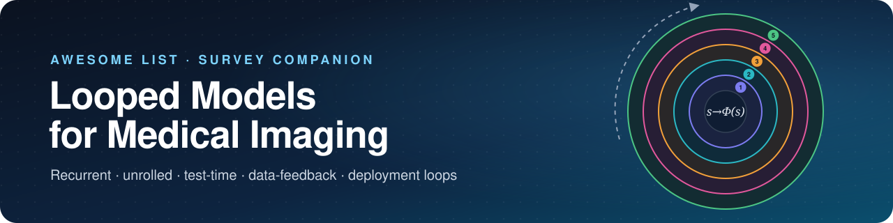
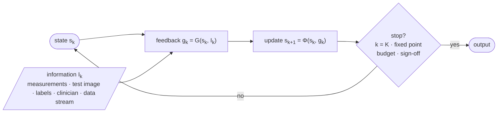

<!-- This file is generated by scripts/build_readme.py from data/papers.csv and config/taxonomy.json. Do not edit it by hand. -->

<div align="center">



# Awesome Looped Models for Medical Imaging

[](https://awesome.re)
[](#contents)
[](#the-five-loop-families)
[](#how-to-read-this-list)
[](../../commits/main)
[](CONTRIBUTING.md)
[](LICENSE)

The companion list to the survey **_Looped Models for Medical Imaging: A Survey of Iterative Architectures,<br>
Test-Time Adaptation, and Feedback_**: papers and code in which a medical imaging model, its training data<br>
or the deployed system is updated by repeated computation rather than a single feed-forward pass.

**[🌐 Website](https://big-matrix-r-and-d-lab.github.io/Awesome-Looped-Models-for-Medical-Imaging/)** &nbsp;·&nbsp; **[Browse papers](#contents)** &nbsp;·&nbsp; **[What is a loop?](#what-is-a-looped-model)** &nbsp;·&nbsp; **[Add a paper](../../issues/new?template=add-paper.yml)** &nbsp;·&nbsp; **[Cite](#citation)**

</div>

## What is a looped model?

A feed-forward network maps an input to an output once. Many medical imaging methods instead refine a result through iteration: reconstruction networks alternate a learned prior with physics-based data consistency, equilibrium networks define their output as a fixed point, segmentation models adapt to each new scan, semi-supervised pipelines feed their own predictions back as labels, and clinical systems are corrected by annotators or recalibrated after a scanner change.

The survey describes every such loop by four elements: the **state** that is iterated, the **operator** that updates it, the **feedback** that closes the loop, and the **stopping rule**:

$$s_{k+1} = \Phi\left(s_k, g_k; \theta\right), \qquad g_k = G\left(s_k, I_k\right)$$

where $I_k$ is the information available at step $k$: measurements, a test image, unlabeled data, an annotator or a deployment stream.



## The five loop families

The families differ in **what is iterated** and in **how long one iteration takes**, from milliseconds inside a forward pass to months in deployment (survey Fig. 1). Risk grows as the loop moves outward.

| Loop family | What is iterated | Timescale | Typical risk |
| --- | --- | :-: | --- |
| 🔁 **1. Recurrent, recursive & equilibrium** | features, hidden state | ms per iteration | non-convergence, computational cost |
| 🧮 **2. Unrolled & data-consistency reconstruction** | image, k-space | ms per iteration | shift in the forward operator A, artifacts |
| ⏱️ **3. Test-time loops** | parameters, prompts | seconds per case | overfitting, error accumulation |
| 🔄 **4. Data-feedback training loops** | labels, training set | hours–days | confirmation bias, collapse |
| 🩺 **5. Human, deployment & lifelong loops** | deployed model, memory | weeks–months | drift, forgetting, governance |

Papers are grouped by the survey's own classification (its Figure 3), defined in [`config/taxonomy.json`](config/taxonomy.json): 6 classes (the five families plus background surveys), each with a fixed set of branches. No other sections exist, and new ones cannot be created by a submission. See the [classification guide](docs/classification-guide.md).

## How to read this list

- **Model** is the method name; **‡** marks the three records that the survey's curation audit judged to be context-level rather than core evidence.
- **Paper** links to the DOI or official proceedings page (arXiv for preprints). The small line underneath gives the imaging modality, the task and the reference number in the survey.
- **Code** shows the repository with live GitHub stars. A plain badge is a link from the curated record or the paper's official page; a badge marked <sup>*</sup> was identified in the survey's follow-up checks (Supplementary Table S10). The RIM, CIRIM and RecurrentVarNet links lead to the NKI-AI DIRECT framework rather than paper-specific releases. `—` means no repository with method code was found.
- Venues shown as *arXiv* are preprints that have not (yet) been peer reviewed.

## At a glance

**56** papers &nbsp;·&nbsp; **49** primary method and application records &nbsp;·&nbsp; **7** surveys (background only) &nbsp;·&nbsp; **3** context-level (‡) &nbsp;·&nbsp; **29** with a code link

> [!NOTE]
> The list starts from the survey's curated corpus (searches through 22 October 2026). That corpus is curated rather than exhaustive, so the counts describe this collection, not the whole literature. **0** further papers are awaiting a maintainer's classification in [`data/review_queue.csv`](data/review_queue.csv).

| Year | Papers | |
| :-- | --: | :-- |
| 2018 | 1 | ██ |
| 2019 | 4 | ███████ |
| 2020 | 2 | ████ |
| 2021 | 6 | ███████████ |
| 2022 | 8 | ███████████████ |
| 2023 | 8 | ███████████████ |
| 2024 | 7 | █████████████ |
| 2025 | 13 | ████████████████████████ |
| 2026 | 7 | █████████████ |

## Contents

| | Loop family | Papers | Primary | Branches |
| :-: | :-- | :-: | :-: | :-- |
| 🔁 | **[1. Recurrent, recursive & equilibrium](#-1-recurrent-recursive--equilibrium)** | 7 | Yes | [Recurrent conv. segmentation](#recurrent-conv-segmentation)&nbsp;<sub>2</sub> · [Recursive transformer U-Net](#recursive-transformer-u-net)&nbsp;<sub>1</sub> · [Recurrent dynamic MRI recon.](#recurrent-dynamic-mri-recon)&nbsp;<sub>1</sub> · [Recurrent mask refinement](#recurrent-mask-refinement)&nbsp;<sub>1</sub> · [Deep equilibrium models](#deep-equilibrium-models)&nbsp;<sub>2</sub> |
| 🧮 | **[2. Unrolled & data-consistency reconstruction](#-2-unrolled--data-consistency-reconstruction)** | 9 | Yes | [Weight-shared unrolling](#weight-shared-unrolling)&nbsp;<sub>1</sub> · [Recurrent inference machines](#recurrent-inference-machines)&nbsp;<sub>2</sub> · [Recurrent variational network](#recurrent-variational-network)&nbsp;<sub>1</sub> · [Multi-prior, edge, alignment DUNs](#multi-prior-edge-alignment-duns)&nbsp;<sub>3</sub> · [Multi-contrast SR unfolding](#multi-contrast-sr-unfolding)&nbsp;<sub>1</sub> · [Motion search with data consistency](#motion-search-with-data-consistency)&nbsp;<sub>1</sub> |
| ⏱️ | **[3. Test-time loops](#-3-test-time-loops)** | 13 | Yes | [Per-image weight / norm. adaptation](#per-image-weight--norm-adaptation)&nbsp;<sub>3</sub> · [Input, prompt, embedding TTA](#input-prompt-embedding-tta)&nbsp;<sub>4</sub> · [Test-time training](#test-time-training)&nbsp;<sub>3</sub> · [Concept-level correction](#concept-level-correction)&nbsp;<sub>1</sub> · [VLM reasoning, test-time scaling](#vlm-reasoning-test-time-scaling)&nbsp;<sub>2</sub> |
| 🔄 | **[4. Data-feedback training loops](#-4-data-feedback-training-loops)** | 11 | Yes | [Co-training, mutual learning](#co-training-mutual-learning)&nbsp;<sub>4</sub> · [Self-training, distillation](#self-training-distillation)&nbsp;<sub>3</sub> · [Pseudo-label-guided synthesis](#pseudo-label-guided-synthesis)&nbsp;<sub>1</sub> · [Training-data refinement](#training-data-refinement)&nbsp;<sub>1</sub> · [Active learning](#active-learning)&nbsp;<sub>2</sub> |
| 🩺 | **[5. Human, deployment & lifelong loops](#-5-human-deployment--lifelong-loops)** | 9 | Yes | [Interactive / clinician correction](#interactive--clinician-correction)&nbsp;<sub>3</sub> · [HITL annotation engines](#hitl-annotation-engines)&nbsp;<sub>2</sub> · [Post-deployment drift correction](#post-deployment-drift-correction)&nbsp;<sub>1</sub> · [Continual memory replay](#continual-memory-replay)&nbsp;<sub>1</sub> · [Self-improving agents, roadmap](#self-improving-agents-roadmap)&nbsp;<sub>2</sub> |
| 📚 | **[S. Surveys](#-s-surveys)** | 7 | No | [Background only](#background-only)&nbsp;<sub>7</sub> |

## 🔁 1. Recurrent, recursive & equilibrium

> The loop closes inside a single forward pass: a block with shared weights is applied repeatedly to features, to an output estimate or to a hidden state, or the output is defined as a fixed point of such a block (deep equilibrium models).

### Recurrent conv. segmentation

| Model | Paper | Venue | Code |
| :-- | :-- | :-: | :-: |
| **R2U++** | [R2U++: a multiscale recurrent residual U-Net with dense skip connections for medical image segmentation](https://doi.org/10.1007/s00521-022-07419-7)<br><sub><code>medical image segmentation</code> semantic segmentation · ref.&nbsp;[25]</sub> | Neural Comput. Appl.<br><sub>2022</sub> | — |
| **R2U‑Net** | [Recurrent residual U-Net for medical image segmentation](https://doi.org/10.1117/1.JMI.6.1.014006)<br><sub><code>retinal fundus; dermoscopy; lung imaging</code> semantic segmentation · ref.&nbsp;[24]</sub> | J. Med. Imaging<br><sub>2019</sub> | — |

<p align="right"><a href="#contents"><sub>↑ back to top</sub></a></p>

### Recursive transformer U-Net

| Model | Paper | Venue | Code |
| :-- | :-- | :-: | :-: |
| **ReT‑UNet** | [A novel recursive transformer-based U-Net architecture for enhanced multi-scale medical image segmentation](https://doi.org/10.1016/j.compbiomed.2025.110658)<br><sub><code>cardiac; pulmonary nodule; polyp imaging</code> medical image segmentation · ref.&nbsp;[48]</sub> | Comput. Biol. Med.<br><sub>2025</sub> | — |

<p align="right"><a href="#contents"><sub>↑ back to top</sub></a></p>

### Recurrent dynamic MRI recon.

| Model | Paper | Venue | Code |
| :-- | :-- | :-: | :-: |
| **CRNN‑MRI** | [Convolutional Recurrent Neural Networks for Dynamic MR Image Reconstruction](https://doi.org/10.1109/TMI.2018.2863670)<br><sub><code>dynamic cardiac MRI</code> reconstruction · ref.&nbsp;[27]</sub> | IEEE TMI<br><sub>2019</sub> | [](https://github.com/cq615/CRNN-MRI) |

<p align="right"><a href="#contents"><sub>↑ back to top</sub></a></p>

### Recurrent mask refinement

| Model | Paper | Venue | Code |
| :-- | :-- | :-: | :-: |
| **RP‑Net** | [Recurrent Mask Refinement for Few-Shot Medical Image Segmentation](https://doi.org/10.1109/ICCV48922.2021.00389)<br><sub><code>abdomen CT; abdomen MRI</code> few-shot organ segmentation · ref.&nbsp;[26]</sub> | ICCV<br><sub>2021</sub> | [](https://github.com/uci-cbcl/RP-Net)<sup>*</sup> |

<p align="right"><a href="#contents"><sub>↑ back to top</sub></a></p>

### Deep equilibrium models

| Model | Paper | Venue | Code |
| :-- | :-- | :-: | :-: |
| **DEAR‑net** | [Deep equilibrium-adversarial robust unfolding network for MRI reconstruction](https://doi.org/10.1002/mp.70185)<br><sub><code>MRI</code> undersampled reconstruction · ref.&nbsp;[50]</sub> | Med. Phys.<br><sub>2025</sub> | — |
| **EDEM** | [An efficient deep equilibrium model for medical image segmentation](https://doi.org/10.1016/j.compbiomed.2022.105831)<br><sub><code>histopathology images</code> nuclei segmentation · ref.&nbsp;[49]</sub> | Comput. Biol. Med.<br><sub>2022</sub> | — |

<p align="right"><a href="#contents"><sub>↑ back to top</sub></a></p>

## 🧮 2. Unrolled & data-consistency reconstruction

> An iterative solver for an inverse problem (y = Ax + n, e.g. undersampled k-space) is truncated to K stages that alternate a physics-based data-consistency step with a learned prior or regulariser, with or without weights shared across stages or a recurrent hidden state between them.

### Weight-shared unrolling

| Model | Paper | Venue | Code |
| :-- | :-- | :-: | :-: |
| **MoDL** | [MoDL: Model Based Deep Learning Architecture for Inverse Problems](https://doi.org/10.1109/TMI.2018.2865356)<br><sub><code>MRI</code> inverse reconstruction · ref.&nbsp;[1]</sub> | IEEE TMI<br><sub>2018</sub> | [](https://github.com/hkaggarwal/modl)<sup>*</sup> |

<p align="right"><a href="#contents"><sub>↑ back to top</sub></a></p>

### Recurrent inference machines

| Model | Paper | Venue | Code |
| :-- | :-- | :-: | :-: |
| **CIRIM** | [Assessment of data consistency through cascades of independently recurrent inference machines for fast and robust accelerated MRI reconstruction](https://doi.org/10.1088/1361-6560/ac6cc2)<br><sub><code>MRI</code> accelerated MRI reconstruction · ref.&nbsp;[51]</sub> | Phys. Med. Biol.<br><sub>2022</sub> | [](https://github.com/NKI-AI/direct)<sup>*</sup> |
| **RIM** | [Recurrent inference machines for reconstructing heterogeneous MRI data](https://doi.org/10.1016/j.media.2019.01.005)<br><sub><code>MRI</code> accelerated MRI reconstruction · ref.&nbsp;[31]</sub> | MedIA<br><sub>2019</sub> | [](https://github.com/NKI-AI/direct)<sup>*</sup> |

<p align="right"><a href="#contents"><sub>↑ back to top</sub></a></p>

### Recurrent variational network

| Model | Paper | Venue | Code |
| :-- | :-- | :-: | :-: |
| **RecurrentVarNet** | [Recurrent Variational Network: A Deep Learning Inverse Problem Solver applied to the task of Accelerated MRI Reconstruction](https://doi.org/10.1109/CVPR52688.2022.00081)<br><sub><code>multi-coil brain MRI</code> accelerated reconstruction · ref.&nbsp;[32]</sub> | CVPR<br><sub>2022</sub> | [](https://github.com/NKI-AI/direct) |

<p align="right"><a href="#contents"><sub>↑ back to top</sub></a></p>

### Multi-prior, edge, alignment DUNs

| Model | Paper | Venue | Code |
| :-- | :-- | :-: | :-: |
| **DUN‑SA** | [Deep Unfolding Network with Spatial Alignment for multi-modal MRI reconstruction](https://doi.org/10.1016/j.media.2024.103331)<br><sub><code>multi-modal MRI</code> accelerated reconstruction · ref.&nbsp;[54]</sub> | MedIA<br><sub>2025</sub> | — |
| **JEO4MRI** | [Joint Edge Optimization Deep Unfolding Network for Accelerated MRI Reconstruction](https://arxiv.org/abs/2405.05564)<br><sub><code>single-coil and multi-coil MRI</code> accelerated reconstruction · ref.&nbsp;[53]</sub> | arXiv<br><sub>2024</sub> | [](https://github.com/Tsaiyue/JEO4MRI) |
| **CAMP‑Net** | [CAMP-Net: Consistency-Aware Multi-Prior Network for Accelerated MRI Reconstruction](https://arxiv.org/abs/2306.11238)<br><sub><code>multi-coil MRI</code> accelerated reconstruction; T2 mapping estimation · ref.&nbsp;[52]</sub> | arXiv<br><sub>2023</sub> | [](https://github.com/lpzhang/CAMP-Net) |

<p align="right"><a href="#contents"><sub>↑ back to top</sub></a></p>

### Multi-contrast SR unfolding

| Model | Paper | Venue | Code |
| :-- | :-- | :-: | :-: |
| **MGDUN** | [Model-Guided Multi-Contrast Deep Unfolding Network for MRI Super-resolution Reconstruction](https://doi.org/10.1145/3503161.3548068)<br><sub><code>multi-contrast MRI</code> super-resolution reconstruction · ref.&nbsp;[55]</sub> | ACM MM<br><sub>2022</sub> | [](https://github.com/yggame/MGDUN) |

<p align="right"><a href="#contents"><sub>↑ back to top</sub></a></p>

### Motion search with data consistency

| Model | Paper | Venue | Code |
| :-- | :-- | :-: | :-: |
| **neuroMoCo** | [Data Consistent Deep Rigid MRI Motion Correction](https://arxiv.org/abs/2301.10365)<br><sub><code>MRI; 2D fast spin-echo brain MRI</code> retrospective rigid intra-slice motion correction · ref.&nbsp;[56]</sub> | arXiv<br><sub>2023</sub> | [](https://github.com/nalinimsingh/neuroMoCo) |

<p align="right"><a href="#contents"><sub>↑ back to top</sub></a></p>

## ⏱️ 3. Test-time loops

> Model state (normalisation statistics, a parameter subset, an input transformation, a prompt or embedding, or a sequence of reasoning steps) is updated at inference using the test case or target-domain data, usually label-free; the loop resets per case (episodic) or carries forward (continual).

### Per-image weight / norm. adaptation

| Model | Paper | Venue | Code |
| :-- | :-- | :-: | :-: |
| **Multi-view co-training TTA** | [Single Image Test-Time Adaptation via Multi-View Co-Training](https://arxiv.org/abs/2506.23705)<br><sub><code>Breast MRI</code> volumetric tumor segmentation · ref.&nbsp;[58]</sub> | arXiv<br><sub>2025</sub> | [](https://github.com/smriti-joshi/muvi) |
| **PTTEA** | [Progressive Test Time Energy Adaptation for Medical Image Segmentation](https://doi.org/10.1109/ICCV51701.2025.02074)<br><sub><code>MRI (bSSFP, T1-weighted, T2-weighted); X-ray</code> cardiac, spinal-cord, and lung segmentation · ref.&nbsp;[57]</sub> | ICCV<br><sub>2025</sub> | [Project](https://voldemort108x.github.io/pttea_seg/) |
| **Test-time adaptable NN** | [Test-Time Adaptable Neural Networks for Robust Medical Image Segmentation](https://doi.org/10.1016/j.media.2020.101907)<br><sub><code>MRI</code> brain, heart, and prostate segmentation · ref.&nbsp;[6]</sub> | MedIA<br><sub>2021</sub> | [](https://github.com/neerakara/test-time-adaptable-neural-networks-for-domain-generalization) |

<p align="right"><a href="#contents"><sub>↑ back to top</sub></a></p>

### Input, prompt, embedding TTA

| Model | Paper | Venue | Code |
| :-- | :-- | :-: | :-: |
| **MedSAM‑TTA** | [Test-time Adaptation for Foundation Medical Segmentation Model Without Parametric Updates](https://doi.org/10.1109/ICCV51701.2025.01867)<br><sub><code>medical imaging</code> MedSAM lesion/organ segmentation · ref.&nbsp;[61]</sub> | ICCV<br><sub>2025</sub> | — |
| **SAM‑TTA** | [SAM-aware Test-time Adaptation for Universal Medical Image Segmentation](https://arxiv.org/abs/2506.05221)<br><sub><code>Medical imaging; six grayscale and two color tasks</code> universal image segmentation · ref.&nbsp;[62]</sub> | arXiv<br><sub>2025</sub> | [](https://github.com/JianghaoWu/SAM-TTA) |
| **VPTTA** | [Each Test Image Deserves A Specific Prompt: Continual Test-Time Adaptation for 2D Medical Image Segmentation](https://doi.org/10.1109/CVPR52733.2024.01063)<br><sub><code>fundus/retinal imaging</code> optic disc/optic cup segmentation; polyp segmentation · ref.&nbsp;[60]</sub> | CVPR<br><sub>2024</sub> | [](https://github.com/Chen-Ziyang/VPTTA) |
| **OptTTA** | [OptTTA: Learnable Test-Time Augmentation for Source-Free Medical Image Segmentation Under Domain Shift](https://proceedings.mlr.press/v172/tomar22a.html)<br><sub><code>MRI</code> multi-anatomy segmentation · ref.&nbsp;[59]</sub> | MIDL<br><sub>2022</sub> | [](https://github.com/devavratTomar/OptTTA) |

<p align="right"><a href="#contents"><sub>↑ back to top</sub></a></p>

### Test-time training

| Model | Paper | Venue | Code |
| :-- | :-- | :-: | :-: |
| **TTT‑UNet** | [TTT-UNet: Enhancing U-Net with Test-Time Training Layers for Biomedical Image Segmentation](https://proceedings.mlr.press/v315/zhou26a.html)<br><sub><code>CT; MRI; endoscopy; microscopy</code> biomedical image segmentation · ref.&nbsp;[64]</sub> | MIDL<br><sub>2026</sub> | [](https://github.com/rongzhou7/TTT-UNet) |
| **4D TTT interpolation** | [Test Time Training for 4D Medical Image Interpolation](https://arxiv.org/abs/2502.02341)<br><sub><code>4D cardiac and lung medical imaging</code> 4D medical image/frame interpolation · ref.&nbsp;[65]</sub> | arXiv<br><sub>2025</sub> | [](https://github.com/ChaosTheProducer/TTT4D)<sup>*</sup> |
| **Med‑TTT** | [Med-TTT: Vision Test-Time Training model for Medical Image Segmentation](https://arxiv.org/abs/2410.02523)<br><sub><code>Medical imaging; modality not specified</code> image segmentation · ref.&nbsp;[63]</sub> | arXiv<br><sub>2024</sub> | [](https://github.com/Jiashu-Xu/Med-TTT) |

<p align="right"><a href="#contents"><sub>↑ back to top</sub></a></p>

### Concept-level correction

| Model | Paper | Venue | Code |
| :-- | :-- | :-: | :-: |
| **Training‑free&nbsp;TTI** | [Training-free Test-time Improvement for Explainable Medical Image Classification](https://arxiv.org/abs/2506.18070)<br><sub><code>Skin images; white-blood-cell images</code> explainable medical image classification with concept bottlenecks · ref.&nbsp;[38]</sub> | arXiv<br><sub>2025</sub> | [](https://github.com/riverback/TF-TTI-XMed) |

<p align="right"><a href="#contents"><sub>↑ back to top</sub></a></p>

### VLM reasoning, test-time scaling

| Model | Paper | Venue | Code |
| :-- | :-- | :-: | :-: |
| **Medical test-time scaling**&nbsp;‡ | [Model and Task-Aware Test-Time Scaling Strategies for Large Language and Vision-Language Models in Medicine: Evaluation Study](https://doi.org/10.2196/90693)<br><sub><code>Text and multimodal medical data</code> Medical QA; medical calculation; medical VQA · ref.&nbsp;[67]</sub> | JMIR<br><sub>2026</sub> | — |
| **ViTAR** | [Think Twice to See More: Iterative Visual Reasoning in Medical VLMs](https://arxiv.org/abs/2510.10052)<br><sub><code>Medical images</code> Medical visual question answering and diagnosis · ref.&nbsp;[66]</sub> | arXiv<br><sub>2025</sub> | [](https://github.com/JLINEkai/ViTAR)<sup>*</sup> |

<p align="right"><a href="#contents"><sub>↑ back to top</sub></a></p>

## 🔄 4. Data-feedback training loops

> The training set is updated over rounds from the model's own outputs: self-training pseudo-labels, co-training or mutual learning between models or views, pseudo-label-guided synthesis, refinement of the training data, or active learning in which an annotator labels the samples the model selects.

### Co-training, mutual learning

| Model | Paper | Venue | Code |
| :-- | :-- | :-: | :-: |
| **UC‑Seg** | [Uncertainty-aware Cross-training for Semi-supervised Medical Image Segmentation](https://doi.org/10.1109/TIP.2025.3599783)<br><sub><code>MRI; CT; 2D clinical images</code> multi-task medical image segmentation · ref.&nbsp;[71]</sub> | IEEE TIP<br><sub>2025</sub> | [](https://github.com/taozh2017/UCSeg) |
| **Semi‑CML** | [Multi-modal contrastive mutual learning and pseudo-label re-learning for semi-supervised medical image segmentation](https://doi.org/10.1016/j.media.2022.102656)<br><sub><code>multi-modal medical imaging</code> segmentation · ref.&nbsp;[70]</sub> | MedIA<br><sub>2023</sub> | — |
| **SLC‑Net** | [Semi-Supervised Medical Image Segmentation Using Cross-Model Pseudo-Supervision with Shape Awareness and Local Context Constraints](https://doi.org/10.1007/978-3-031-16452-1_14)<br><sub><code>MRI</code> cardiac and prostate segmentation · ref.&nbsp;[69]</sub> | MICCAI<br><sub>2022</sub> | [](https://github.com/igip-liu/SLC-Net) |
| **UMCT** | [3D semi-supervised learning with uncertainty-aware multi-view co-training](https://doi.org/10.1109/WACV45572.2020.9093608)<br><sub><code>3D CT</code> segmentation · ref.&nbsp;[68]</sub> | WACV<br><sub>2020</sub> | — |

<p align="right"><a href="#contents"><sub>↑ back to top</sub></a></p>

### Self-training, distillation

| Model | Paper | Venue | Code |
| :-- | :-- | :-: | :-: |
| **SDBS‑Net** | [Self-distillation double student network for semi-supervised medical image segmentation](https://doi.org/10.3389/fphys.2026.1755067)<br><sub><code>3D CT; 3D MRI</code> left atrium and pancreas segmentation · ref.&nbsp;[73]</sub> | Front. Physiol.<br><sub>2026</sub> | — |
| **DUST** | [Self-training with dual uncertainty for semi-supervised MRI image segmentation](https://doi.org/10.1016/j.bspc.2024.106355)<br><sub><code>MRI</code> cardiac and prostate segmentation · ref.&nbsp;[72]</sub> | BSPC<br><sub>2024</sub> | — |
| **AIDE** | [Annotation-efficient deep learning for automatic medical image segmentation](https://doi.org/10.1038/s41467-021-26216-9)<br><sub><code>breast MRI; CT/MRI segmentation datasets</code> segmentation · ref.&nbsp;[7]</sub> | Nat. Commun.<br><sub>2021</sub> | [](https://github.com/lich0031/AIDE)<sup>*</sup> |

<p align="right"><a href="#contents"><sub>↑ back to top</sub></a></p>

### Pseudo-label-guided synthesis

| Model | Paper | Venue | Code |
| :-- | :-- | :-: | :-: |
| **SA‑CPS** | [Pseudo-Label Guided Image Synthesis for Semi-Supervised COVID-19 Pneumonia Infection Segmentation](https://doi.org/10.1109/TMI.2022.3217501)<br><sub><code>COVID-19 chest CT</code> pneumonia infection segmentation · ref.&nbsp;[74]</sub> | IEEE TMI<br><sub>2023</sub> | [](https://github.com/FeiLyu/SASSL) |

<p align="right"><a href="#contents"><sub>↑ back to top</sub></a></p>

### Training-data refinement

| Model | Paper | Venue | Code |
| :-- | :-- | :-: | :-: |
| **Iterative Data Refinement** | [Iterative Data Refinement for Self-Supervised MR Image Reconstruction](https://arxiv.org/abs/2211.13440)<br><sub><code>MRI</code> accelerated MR image reconstruction · ref.&nbsp;[75]</sub> | arXiv<br><sub>2022</sub> | — |

<p align="right"><a href="#contents"><sub>↑ back to top</sub></a></p>

### Active learning

| Model | Paper | Venue | Code |
| :-- | :-- | :-: | :-: |
| **Brain‑tumor&nbsp;AL**&nbsp;‡ | [Active Learning in Brain Tumor Segmentation with Uncertainty Sampling and Annotation Redundancy Restriction](https://doi.org/10.1007/s10278-024-01037-6)<br><sub><code>multi-institutional brain MRI</code> contrast-enhancing brain tumor segmentation · ref.&nbsp;[77]</sub> | J. Imaging Inform. Med.<br><sub>2024</sub> | [](https://github.com/naddan27/ActiveLearning)<sup>*</sup> |
| **Uncertainty&nbsp;AL** | [Diminishing Uncertainty Within the Training Pool: Active Learning for Medical Image Segmentation](https://doi.org/10.1109/TMI.2020.3048055)<br><sub><code>MRI; CT</code> segmentation · ref.&nbsp;[76]</sub> | IEEE TMI<br><sub>2021</sub> | — |

<p align="right"><a href="#contents"><sub>↑ back to top</sub></a></p>

## 🩺 5. Human, deployment & lifelong loops

> A model is updated around its use: interactive or clinician corrections, human-in-the-loop annotation engines, recalibration after acquisition or scanner shift, continual learning with memory replay, or agents that improve from their own experience.

### Interactive / clinician correction

| Model | Paper | Venue | Code |
| :-- | :-- | :-: | :-: |
| **CoWTalk** | [Refining 3D Medical Segmentation with Verbal Instruction](https://arxiv.org/abs/2603.14496)<br><sub><code>3D arterial anatomy</code> 3D medical segmentation/shape modeling · ref.&nbsp;[80]</sub> | arXiv<br><sub>2026</sub> | — |
| **MedUHIP** | [MedUHIP: Towards Human-In-the-Loop Medical Segmentation](https://arxiv.org/abs/2408.01620)<br><sub><code>Medical images; modality not specified</code> uncertainty-aware medical image segmentation · ref.&nbsp;[79]</sub> | arXiv<br><sub>2024</sub> | — |
| **Interactive&nbsp;MARL** | [Iteratively-Refined Interactive 3D Medical Image Segmentation With Multi-Agent Reinforcement Learning](https://doi.org/10.1109/CVPR42600.2020.00941)<br><sub><code>Medical 3D images; modality not specified</code> interactive 3D image segmentation · ref.&nbsp;[78]</sub> | CVPR<br><sub>2020</sub> | — |

<p align="right"><a href="#contents"><sub>↑ back to top</sub></a></p>

### HITL annotation engines

| Model | Paper | Venue | Code |
| :-- | :-- | :-: | :-: |
| **HAL‑IA** | [HAL-IA: A Hybrid Active Learning framework using Interactive Annotation for medical image segmentation](https://doi.org/10.1016/j.media.2023.102862)<br><sub><code>breast ultrasound; liver CT; BUSI; CXRSet</code> segmentation · ref.&nbsp;[81]</sub> | MedIA<br><sub>2023</sub> | — |
| **H‑AI‑L** | [An integrated iterative annotation technique for easing neural network training in medical image analysis](https://doi.org/10.1038/s42256-019-0018-3)<br><sub><code>whole-slide pathology; prostate MRI</code> segmentation · ref.&nbsp;[8]</sub> | Nat. Mach. Intell.<br><sub>2019</sub> | [](https://github.com/SarderLab/H-AI-L) |

<p align="right"><a href="#contents"><sub>↑ back to top</sub></a></p>

### Post-deployment drift correction

| Model | Paper | Venue | Code |
| :-- | :-- | :-: | :-: |
| **UPA** | [Automatic correction of performance drift under acquisition shift in medical image classification](https://doi.org/10.1038/s41467-023-42396-y)<br><sub><code>mammography; histopathology</code> breast cancer classification; tissue classification · ref.&nbsp;[9]</sub> | Nat. Commun.<br><sub>2023</sub> | [](https://github.com/biomedia-mira/upa)<sup>*</sup> |

<p align="right"><a href="#contents"><sub>↑ back to top</sub></a></p>

### Continual memory replay

| Model | Paper | Venue | Code |
| :-- | :-- | :-: | :-: |
| **Atypical memory replay** | [Memory Replay for Continual Medical Image Segmentation through Atypical Sample Selection](https://doi.org/10.1007/978-3-031-43901-8_49)<br><sub><code>medical images; modality/task datasets not specified on official page</code> segmentation · ref.&nbsp;[10]</sub> | MICCAI<br><sub>2023</sub> | — |

<p align="right"><a href="#contents"><sub>↑ back to top</sub></a></p>

### Self-improving agents, roadmap

| Model | Paper | Venue | Code |
| :-- | :-- | :-: | :-: |
| **MACRO** | [Evolving Medical Imaging Agents via Experience-driven Self-skill Discovery](https://arxiv.org/abs/2603.05860)<br><sub><code>Medical imaging</code> Multi-step image interpretation and tool orchestration · ref.&nbsp;[82]</sub> | arXiv<br><sub>2026</sub> | — |
| **Self-evolving clinical systems**&nbsp;‡ | [The Path to Self-Evolving Clinical Systems: Scaling Medical Agents from Assistance to Autonomy](https://arxiv.org/abs/2607.11175)<br><sub><code>medical imaging; radiology; pathology; ophthalmology</code> sequential clinical decision-making and autonomous medical-agent workflows · ref.&nbsp;[83]</sub> | arXiv<br><sub>2026</sub> | — |

<p align="right"><a href="#contents"><sub>↑ back to top</sub></a></p>

## 📚 S. Surveys

> Review articles used as background only. They are listed for reference but are not primary method or application records and are excluded from the primary-record count.

### Background only

| Model | Paper | Venue | Code |
| :-- | :-- | :-: | :-: |
| **Continual learning survey** | [Continual Learning in Medical Imaging: A Survey and Practical Analysis](https://doi.org/10.1145/3785663)<br><sub><code>medical imaging</code> classification; segmentation; detection; incremental tasks · ref.&nbsp;[21]</sub> | ACM CSUR<br><sub>2026</sub> | [](https://github.com/BioMedIA-MBZUAI/awesome-cl-in-medical) |
| **Continual learning review** | [Continual learning in medical image analysis: A comprehensive review of recent advancements and future prospects](https://doi.org/10.1016/j.media.2025.103730)<br><sub><code>multiple medical imaging modalities</code> classification; detection; segmentation; evolving tasks · ref.&nbsp;[20]</sub> | MedIA<br><sub>2025</sub> | — |
| **MRI reconstruction survey** | [A Comprehensive Survey on Magnetic Resonance Image Reconstruction](https://arxiv.org/abs/2503.07097)<br><sub><code>MRI</code> reconstruction from undersampled or low-quality MRI data · ref.&nbsp;[17]</sub> | arXiv<br><sub>2025</sub> | — |
| **Deep active learning survey** | [A comprehensive survey on deep active learning in medical image analysis](https://doi.org/10.1016/j.media.2024.103201)<br><sub><code>medical images</code> annotation-efficient analysis · ref.&nbsp;[19]</sub> | MedIA<br><sub>2024</sub> | [](https://github.com/LightersWang/Awesome-Active-Learning-for-Medical-Image-Analysis)<sup>*</sup> |
| **AutoML&nbsp;survey** | [AutoML Systems For Medical Imaging](https://arxiv.org/abs/2306.04750)<br><sub><code>medical imaging</code> automated model design and optimization · ref.&nbsp;[22]</sub> | arXiv<br><sub>2023</sub> | — |
| **Active learning & HITL survey** | [A Survey on Active Learning and Human-in-the-Loop Deep Learning for Medical Image Analysis](https://doi.org/10.1016/j.media.2021.102062)<br><sub><code>medical imaging</code> diagnosis; detection; segmentation; annotation · ref.&nbsp;[18]</sub> | MedIA<br><sub>2021</sub> | — |
| **Reconstruction survey** | [A survey on deep learning in medical image reconstruction](https://doi.org/10.1016/j.imed.2021.03.003)<br><sub><code>MRI; CT; PET; ultrasound; other medical imaging</code> medical image reconstruction · ref.&nbsp;[16]</sub> | Intell. Med.<br><sub>2021</sub> | — |

<p align="right"><a href="#contents"><sub>↑ back to top</sub></a></p>

## Contributing

Know a looped model for medical imaging that belongs here, or spotted a wrong link? Contributions are very welcome.

> [!TIP]
> **Quickest:** open an issue with the [**Add a paper**](../../issues/new?template=add-paper.yml) template.<br>
> **Pull request:** add a row to [`data/papers.csv`](data/papers.csv) with an approved `taxonomy_class` and `taxonomy_subcategory`, then run `python scripts/build_readme.py`.

> [!IMPORTANT]
> Never edit this README by hand. It is generated from the CSV, and the next build overwrites manual changes. To change the intro or footer, edit [`scripts/templates/`](scripts/templates).

See [CONTRIBUTING.md](CONTRIBUTING.md) for the column definitions and the [classification guide](docs/classification-guide.md) for the taxonomy rules. The taxonomy itself only changes through a maintainer-approved update to [`config/taxonomy.json`](config/taxonomy.json) that follows the survey's Figure 3. How each of the survey's 56 records was imported is documented in the [initial import report](docs/initial-import-report.md).

## Citation

If this list helps your research, please cite the survey:

```bibtex
@misc{saswato2026looped,
  title  = {Looped Models for Medical Imaging: A Survey of Iterative Architectures, Test-Time Adaptation, and Feedback},
  author = {Saswato, Aritra Islam and Karim, Labiba Faiza and Khan, Md. Misbah and Khan, Nishan and Ahmed, Istiak and
            Ahmed, Galib and Sanjid, Kazi Shahriar and Hossain, Md. Tanzim and Uddin, M. Monir},
  year   = {2026},
  note   = {Preprint, October 2026}
}
```

GitHub's **Cite this repository** button gives a citation for the list itself ([`CITATION.cff`](CITATION.cff)).

## License

[](https://creativecommons.org/publicdomain/zero/1.0/)

To the extent possible under law, the contributors have waived all copyright and related rights to this list. Each listed paper and code repository remains under its own license.

<div align="center">
<br>
<sub>Maintained by the <a href="https://github.com/Big-Matrix-R-And-D-Lab">Big-Matrix R&amp;D Lab</a>, North South University. If this list is useful, a ⭐ helps others find it.</sub>
</div>
