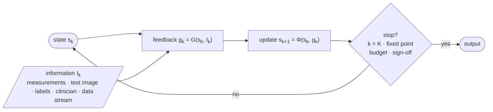

# Awesome Looped Models for Medical Imaging

The companion list to the survey **_Looped Models for Medical Imaging: A Survey of Iterative Architectures, 
Test-Time Adaptation, and Feedback_**: papers and code in which a medical imaging model, its training data 
or the deployed system is updated by repeated computation rather than a single feed-forward pass.

**[🌐 Website](https://big-matrix-r-and-d-lab.github.io/Awesome-Looped-Models-for-Medical-Imaging/)** &nbsp;·&nbsp; **[Browse papers](#contents)** &nbsp;·&nbsp; **[What is a loop?](#what-is-a-looped-model)** &nbsp;·&nbsp; **[Add a paper](../../issues/new?template=add-paper.yml)** &nbsp;·&nbsp; **[Cite](#citation)**

## What is a looped model?

A feed-forward network maps an input to an output once. Many medical imaging methods instead refine a result through iteration: reconstruction networks alternate a learned prior with physics-based data consistency, equilibrium networks define their output as a fixed point, segmentation models adapt to each new scan, semi-supervised pipelines feed their own predictions back as labels, and clinical systems are corrected by annotators or recalibrated after a scanner change.

The survey describes every such loop by four elements: the **state** that is iterated, the **operator** that updates it, the **feedback** that closes the loop, and the **stopping rule**:

$$s_{k+1} = \Phi\left(s_k, g_k; \theta\right), \qquad g_k = G\left(s_k, I_k\right)$$

where $I_k$ is the information available at step $k$: measurements, a test image, unlabeled data, an annotator or a deployment stream.

## The five loop families

The families differ in **what is iterated** and in **how long one iteration takes**, from milliseconds inside a forward pass to months in deployment (survey Fig. 1). Risk grows as the loop moves outward.

{{CLASSES}}

Papers are grouped by the survey's own classification (its Figure 3), defined in [`config/taxonomy.json`](config/taxonomy.json): {{CLASS_COUNT}} classes (the five families plus background surveys), each with a fixed set of branches. No other sections exist, and new ones cannot be created by a submission. See the [classification guide](docs/classification-guide.md).

## How to read this list

- **Model** is the method name; **‡** marks the three records that the survey's curation audit judged to be context-level rather than core evidence.
- **Paper** links to the DOI or official proceedings page (arXiv for preprints). The small line underneath gives the imaging modality, the task and the reference number in the survey.
- **Code** shows the repository with live GitHub stars. A plain badge is a link from the curated record or the paper's official page; a badge marked * was identified in the survey's follow-up checks (Supplementary Table S10). The RIM, CIRIM and RecurrentVarNet links lead to the NKI-AI DIRECT framework rather than paper-specific releases. `—` means no repository with method code was found.
- Venues shown as *arXiv* are preprints that have not (yet) been peer reviewed.

## At a glance

**{{TOTAL}}** papers &nbsp;·&nbsp; **{{PRIMARY}}** primary method and application records &nbsp;·&nbsp; **{{SURVEYS}}** surveys (background only) &nbsp;·&nbsp; **{{CONTEXT}}** context-level (‡) &nbsp;·&nbsp; **{{WITH_CODE}}** with a code link

> [!NOTE]
> The list starts from the survey's curated corpus (searches through 22 October 2026). That corpus is curated rather than exhaustive, so the counts describe this collection, not the whole literature. **{{QUEUED}}** further papers are awaiting a maintainer's classification in [`data/review_queue.csv`](data/review_queue.csv).

{{YEARS}}

## Contents

{{TOC}}
